I make three kinds of things: **websites** that local businesses actually get customers from, **games and 3D spaces** you can walk through, and **coding lessons in Tamil** for people who were told programming is only for English speakers.

Most of it lives in private repos, because it's client work or tools I use every day. Ask me and I'll walk you through any of it.

#### What's on my desk right now

- Redesigning an academy website so every page looks like a real object on a desk, not a template.
- Recording an HTML course in Tanglish: 10 modules, 44 lessons, one café website built from scratch.
- A small CRM and an SEO research tool for my own studio work.
- Unity experiments and real-time architectural walkthroughs on the side.

#### What I reach for

Next.js · React · TypeScript · Astro for the web. 
PHP and Python when something has to run on a server or crunch data. 
C# and Unity for games, Three.js and Blender for 3D.

<b>Why is there a kolam up there?</b>

 

A kolam is a line drawing made with rice flour around a grid of dots. It is drawn at the doorstep every morning, and the best ones are made from a few lines that loop around every dot without a break.

The one above is generated, not drawn by hand. A line starts between two dots, travels diagonally, and bounces off the edges and off a few "mirrors" placed in the grid, until it comes back to where it began. That's the same rule behind sikku kolams. The white lines are rice flour; the yellow one is turmeric.

 

